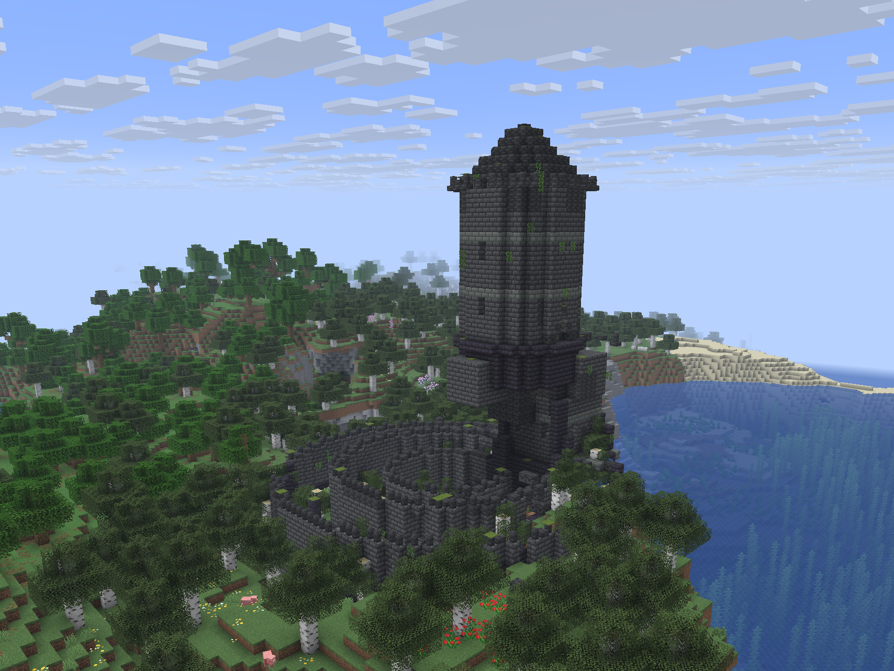
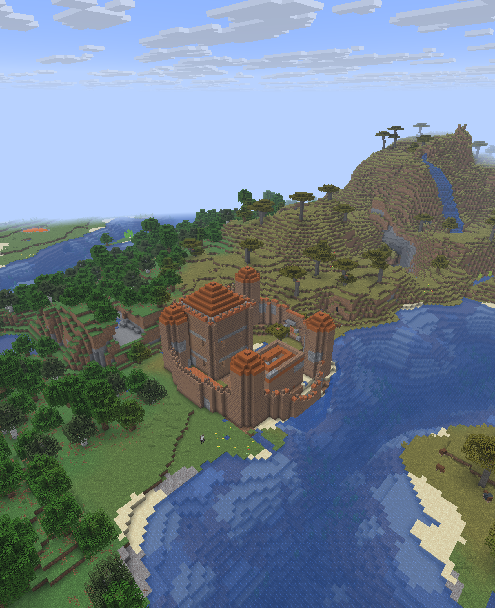
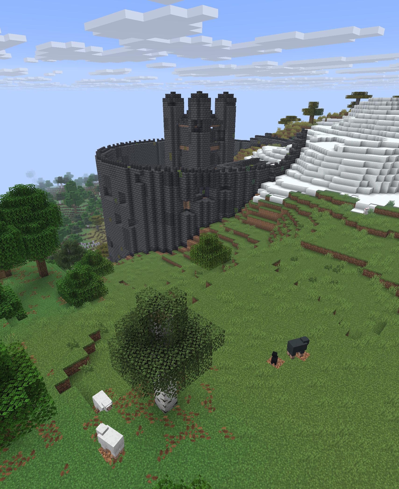
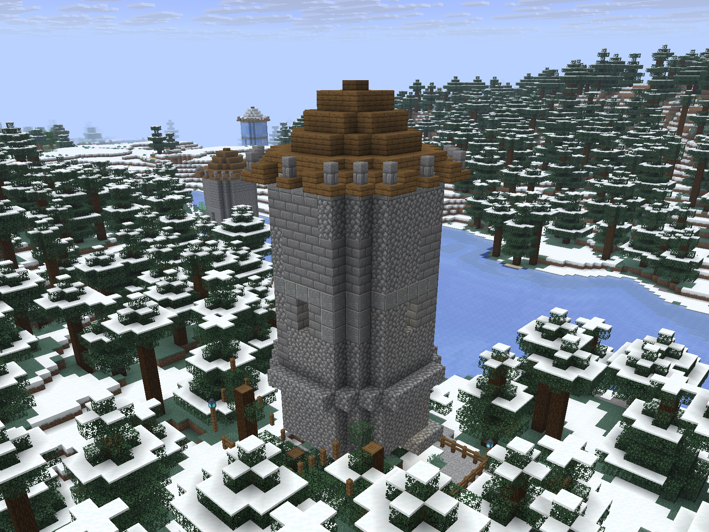
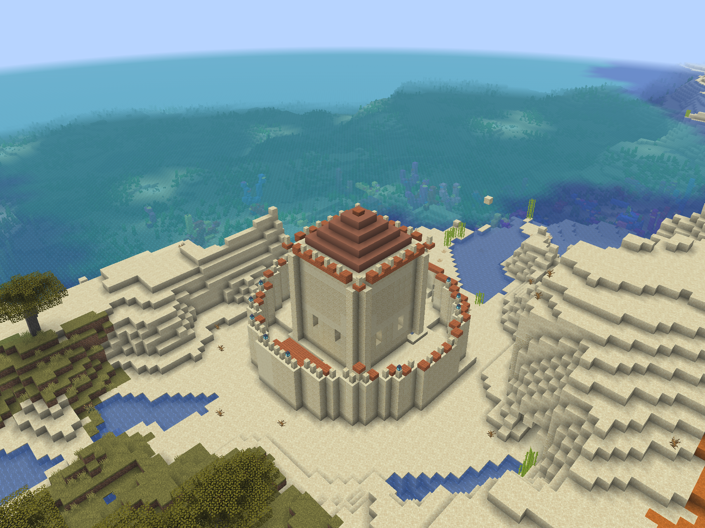
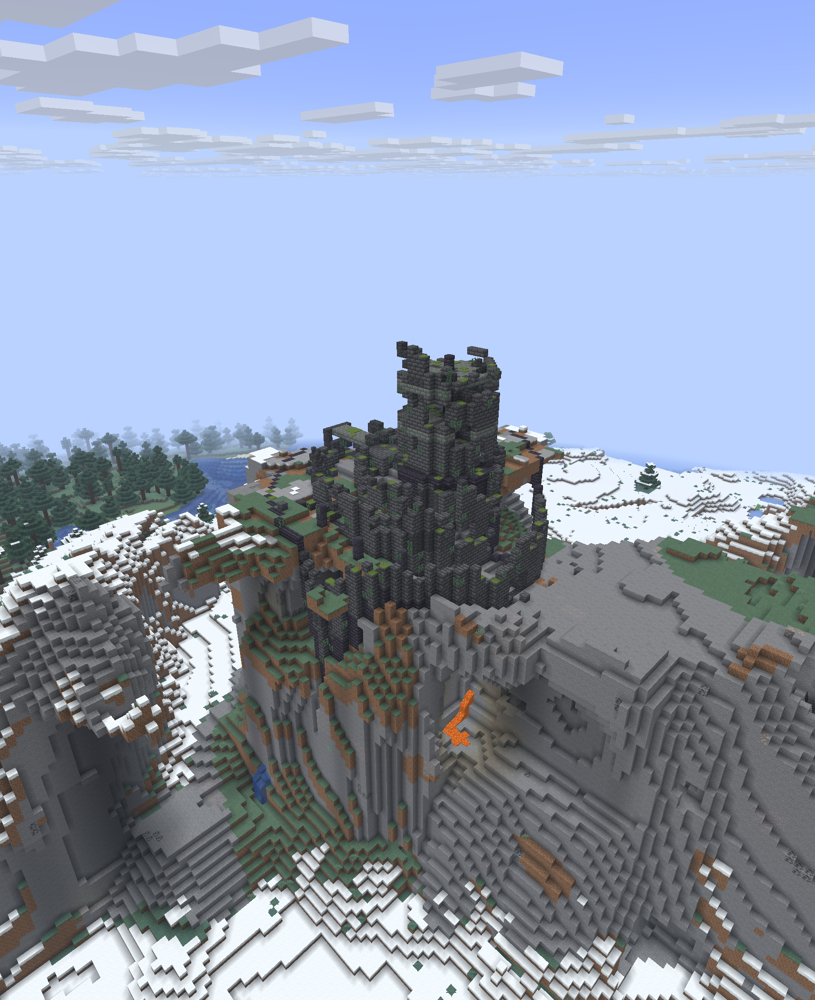

# Village Castles

Adds two kinds of castle to the world: ancient ones in the wilderness, built to fit the land they stand on, and newer ones villagers have raised at the edge of their villages. Every castle is generated for its site, so no two are the same.

- **Ancient castles** stand on high or isolated ground, and the shape of the ground decides the castle:
  - plateau: a citadel walled along the rim
  - hilltop: a terraced ringfort
  - cliff face: a hold built against and into the rock
  - island: a sea fort with a gate a boat fits through
  - headland (water on three sides): a fort behind one wall across the neck
  - ridge: a long wall-hold with a gatehouse tunnel through it
  - jagged peak: a lone watchtower (eyrie)
- **Condition** is rolled per castle: ruined 50%, crumbling 35%, weathered but standing 15%. The more intact, the better the loot and the bigger the garrison.
- **Rarity**: about as rare as woodland mansions, any overworld biome, and never within 8 chunks of a village. A site that fits none of the landforms gets no castle.
- **Garrison**: buried spawner cells, of skeletons (strays in snowy biomes, husks in deserts). A crypt spawner, plus 0-1 more on a ruin, 1-3 on a crumbling castle, 3-4 on a weathered one.
- **Loot**: a treasury vault under the keep (every landform but the ridge) with emeralds, gold, diamonds, golden apples, eye and vex armor trims, the Relic music disc, rarely an enchanted golden apple. Hall chests hold stronghold library loot on a weathered castle, stronghold corridor loot on a crumbling one, dungeon loot on a ruin. Crypt alcoves hold dungeon loot (stronghold corridor on a weathered castle) or suspicious gravel. The courtyard of a ruin has 4-6 more suspicious gravel to brush, a crumbling castle 2-3.
- **Villager castles** attach to about one village in five as it generates: a small watch keep (40%), a medium walled fort (35%) or a large castle seat (25%), in the village's own plains, desert, savanna, taiga or snowy style. They are furnished, lit, and lived in by villagers who spawn at their beds; the keep chest has weaponsmith loot.

## Finding one

```
/locate structure village-castles:ancient_castle
```

Villager castles are part of their village: `/locate structure #minecraft:village` and look at the edge.

## Commands

Run by a player. `list` and `help` are open to everyone; the rest need operator permission (level 2).

| Command | Does |
|---|---|
| `/village-castles ancient <landform> [condition [seed]]` | Builds an ancient castle where you stand. The same seed builds the same castle. |
| `/village-castles villager <size> [biome [seed]]` | Builds a villager castle where you stand. Biome defaults to the one you are in. |
| `/village-castles list` | Lists the landforms, conditions, sizes and biomes. |
| `/village-castles help` | Shows the syntax. |

Landforms: `plateau`, `hilltop`, `cliff_face`, `island`, `headland`, `ridge`, `eyrie`. Conditions: `ruined`, `crumbling`, `weathered`, `pristine` (default: rolled from the seed). Sizes: `small`, `medium`, `large`. Biomes: `plains`, `desert`, `savanna`, `taiga`, `snowy`.

## With other mods

- **[Village Builder](https://github.com/fatlard1993/village-builder)**: a growing village can build a castle of its own, small, medium or large, one per village and never in a village that generated with one.
- **[Village Quests](https://github.com/fatlard1993/village-quests)**: villagers in a village with a castle ask for errands for it (wall stone, arrows, bread, a book, iron, torches) and talk about it, and where an ancient castle is nearby a trusted cleric may send you to bring back a bone from it.

## Screenshots








`screenshots/ancient/` has one for each of the seven landforms, and `screenshots/villager/` the keeps and seats villages build.

## Installing

Server-side only, and Pandorical is not needed: players connect with an unmodified client. Singleplayer works too.

## Development

Building is in [DEVELOPMENT.md](DEVELOPMENT.md).

## License

MIT, see [LICENSE](LICENSE).
